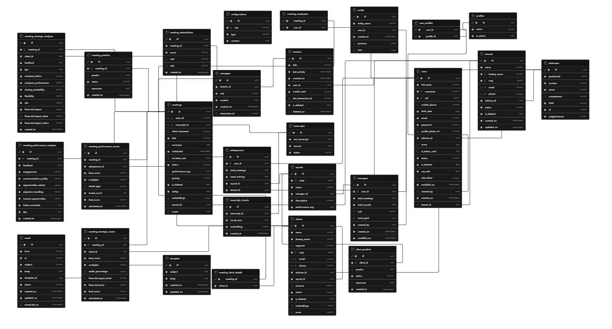

# TCA - Database
Schema geral do banco de dados do projeto TCA. Pode ser acessado por qualquer banco, mas recomendamos a utilização do PostgreSQL, já que é onde o sistema esta hospedado atualmente.

## Modelo MER
O link abaixo leva para um modelo que foi hospedado online na plataforma [DrawSQL](https://drawsql.app/), em que consta com 20 tabelas, das 27 existentes. Não foi possível adicionar todas por limitação ao plano gratuito do site. Segue abaixo o link para visualização.

👉 [Visualização do schema](https://drawsql.app/draw?t=86ed8136-33e3-46d0-b675-c74743daca5d&view=1)

---
### License
Esse projeto está sob licença da [PolyForm Noncommercial](https://github.com/Scacchetti-Lab/tca-database/blob/main/LICENSE)